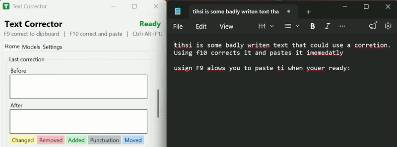
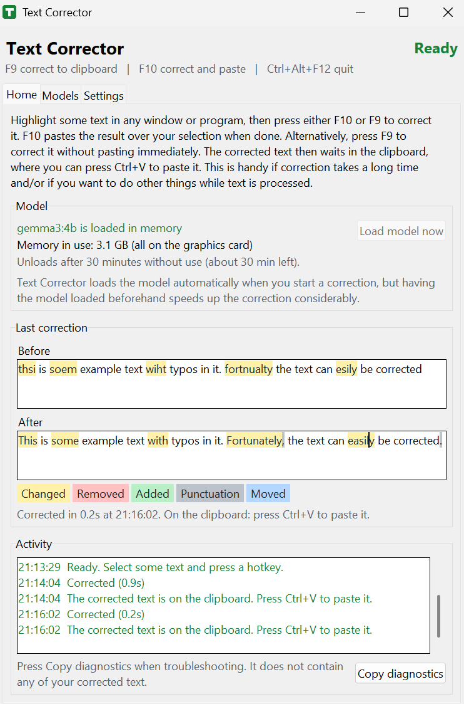
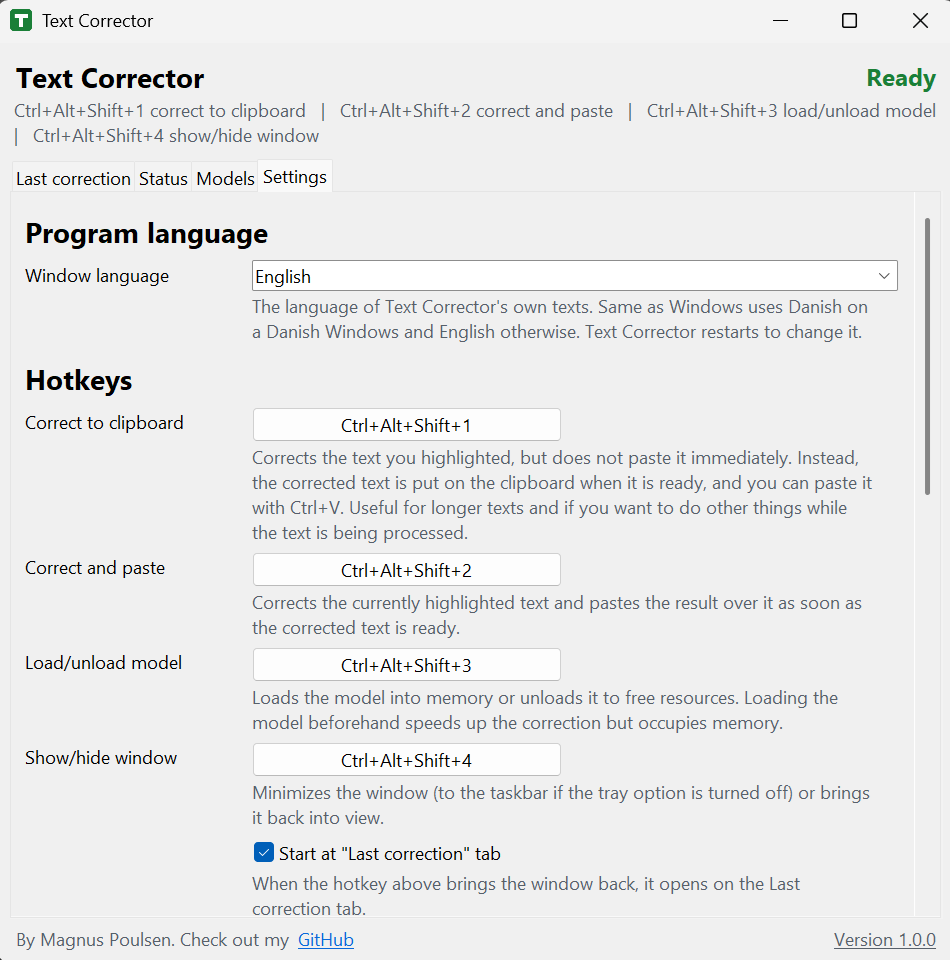

# Text Corrector

[English](README.md) | **Dansk**

**[Hent den nyeste version af Text Corrector](../../releases/latest)** (vælg `TextCorrector-<version>.zip` under "Assets")

Et Windows-værktøj, der er nemt at installere og bruge: markér noget tekst, tryk på en
genvejstast, og stavefejlene bliver rettet af en sprogmodel, der kører på din egen computer, med
[Ollama](https://ollama.com) som motor. Når du først har hentet en sprogmodel, virker programmet
uden internet.

**Privatliv:** din tekst forlader aldrig din pc. Programmet bruger kun internettet, når du henter en
model.

## Hent og brug

1. Hent den nyeste `TextCorrector-<version>.zip` fra [den nyeste udgivelse](../../releases/latest)
   (se under "Assets").
2. Pak den ud, dobbeltklik på `TextCorrector.exe`, og hent en model på fanen Modeller (den
   mellemstore model, gemma4:e2b, er et godt sted at starte).
3. Markér noget tekst i et vilkårligt program, og tryk på **Ctrl+Alt+Shift+2** for at rette den på
   stedet, eller på **Ctrl+Alt+Shift+1** for i stedet at få den rettede tekst i udklipsholderen.

Ingen Python, ingen separat Ollama-installation og intet at sætte op. Alt ligger i programmets egen
mappe: vil du fjerne det, så slet mappen (eller kør `uninstall.bat`).

**Krav:** Windows 10 eller 11 (64-bit), cirka 1,5 GB at hente og 3 til 10 GB diskplads pr.
sprogmodel. Et grafikkort (NVIDIA, AMD eller Intel) er ikke nødvendigt, men gør rettelserne hurtigere.

## Funktioner

- **Virker i alle programmer.** Den rettede tekst erstatter din markering eller venter i
  udklipsholderen, indtil du indsætter den.
- **Virker helt minimeret.** Genvejstaster til det hele (ret, indlæs eller fjern modellen, vis eller
  skjul vinduet), korte opdateringer fra systembakken ("Retter...", "Indsat!"), en lyd for hvert trin
  og et ikon i systembakken, hvis farve viser status.
- **Se, hvad der blev ændret.** Teksten før og efter den seneste rettelse side om side, med
  ændringerne fremhævet.
- **Sikre rettelser.** Hvert svar bliver tjekket, før det indsættes. En del, som modellen laver fejl
  i, prøves igen sætning for sætning eller lades uændret; din tekst går aldrig tabt.
- **Du vælger modellen.** Små, mellemstore og store modeller at hente, enhver anden model fra
  Ollama-biblioteket og et klart overblik over, om den kører på grafikkortet eller processoren.
- **Autodetekterer og virker med de fleste sprog (Tested med dansk engelsk).**
- **Avancerede indstillinger** til at teste din egen systemprompt og dit eget eksempel.

Resten er forklaret i selve programmet.

## Skærmbilleder

## Kendte begrænsninger

- Ret og indsæt gendanner kun tekst i udklipsholderen bagefter; et billede eller en fil, du havde
  kopieret, går tabt. Ret til udklipsholder overskriver altid udklipsholderen.
- Andre sprog end engelsk er eksperimentelle.
- Programmet er ikke kodesigneret, så Windows kan vise en advarsel første gang ("Flere
  oplysninger" og derefter "Kør alligevel"). Nogle antivirusprogrammer markerer også programmer, der
  er lavet med PyInstaller.

Problemer? Se [TROUBLESHOOTING.md](TROUBLESHOOTING.md#dansk). Fejlrapporter og idéer er velkomne som
[GitHub-issues](../../issues); tryk på **Kopiér diagnostik** på fanen Status, og indsæt resultatet i
dit issue.

## Kildekode

Kildekoden til hver version ligger ved dens udgivelse som `TextCorrector-<version>-source.zip`.
[SOURCE_README.md](SOURCE_README.md) (på engelsk) forklarer, hvordan du kører den, og hvordan du
selv bygger programmet.

## Tak og licens

Inspireret af [ai-typing-assistant](https://github.com/patrickloeber/ai-typing-assistant) af Patrick
Loeber (MIT-licens) og [Typing-Assist](https://github.com/x404xx/Typing-Assist) af x404xx; denne
version er siden blevet skrevet om med sin egen kode.

Kildekoden er udgivet under [MIT-licensen](LICENSE). Den indbyggede motor er
[Ollama](https://github.com/ollama/ollama) (MIT), og de sprogmodeller, du henter, har deres egne
licenser (se hver models side). De biblioteker, programmet bruger, står i
[THIRD_PARTY_NOTICES.txt](THIRD_PARTY_NOTICES.txt).
