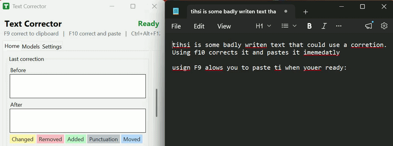
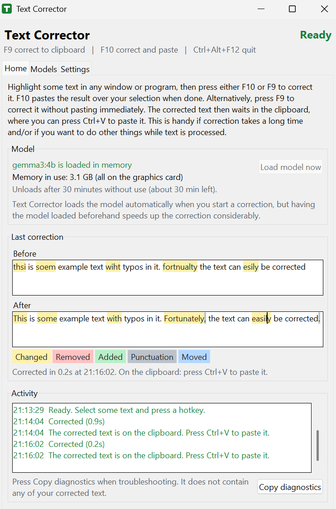
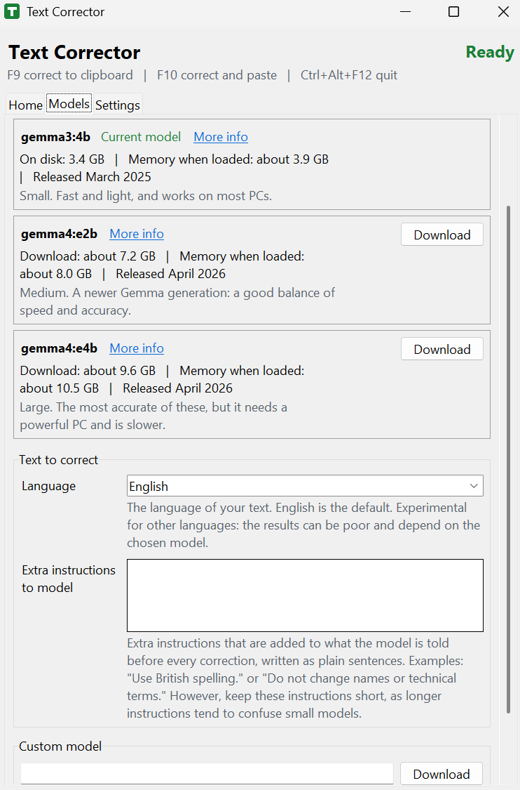
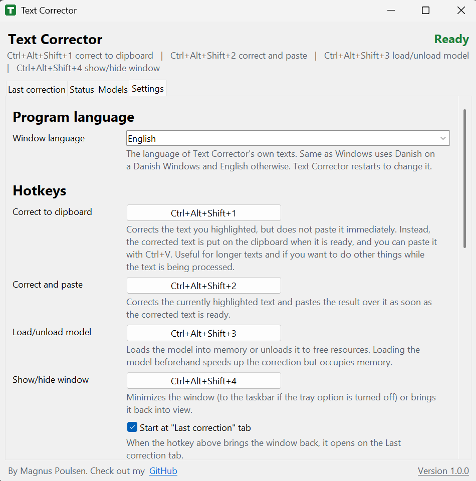

# Text Corrector

A Windows tool that fixes the typos in any text you highlight, with a language model running on
your own PC. / Et Windows-værktøj, der retter stavefejl i den tekst, du markerer, med en sprogmodel,
der kører på din egen pc.

**[Download the latest version / Hent den nyeste version](../../releases/latest)**

Choose your language below / Vælg dit sprog nedenfor:

<!-- ENGLISH START: edit the English text here, between these two markers -->

<b>English: click here to read in English</b>

A simple-to-install-and-use Windows tool: highlight some text, press a hotkey, and it fixes the typos using a local language model.
Everything runs on your own computer, using [Ollama](https://ollama.com) as the engine. After a 
one-time download of a language model from Ollama, it works offline.

**Privacy:** your text never leaves your PC. The only time the program uses the internet is when
you download a model.

## Download and use

1. Get `TextCorrector-1.0.0.zip` (or the newest version) from the [latest release](../../releases/latest) (look under "Assets").
2. Extract it, double-click `TextCorrector.exe` and download a model.

No Python setup, no separate Ollama installation and no virtual environment is needed.
See [The ready-to-use zip](#the-ready-to-use-zip) for details.

**Requirements:** Windows 10 or 11 (64-bit). About 1.5 GB to download, a few GB of disk space once
extracted, and then 3 to 10 GB for each language model you download (you can download more than one). Also, note that you need enough free
memory (RAM or graphics memory) for the model you choose; the Models tab shows roughly how much
each one needs. Small and larger models are available to choose from. A graphics card is optional but speeds up corrections.

## How it works

1. You highlight some text, press a hotkey.
2. The tool copies your selection, sends it to a local Ollama model and asks for a corrected
   version (typos, spelling, casing and punctuation; wording and meaning stay the same).
3. The answer is checked and, depending on the hotkey, either pasted over your selection, or put on
   the clipboard, ready for you to paste with Ctrl+V.

Long texts are corrected paragraph by paragraph, so small models keep track and a part the model
keeps getting wrong is left as it was (the activity log says so) instead of losing the whole text.
If the model's answer does not look like a plain correction (for example extra commentary or
changed line breaks), nothing is pasted for that part and the program tells you why.

## Screenshots

## Details About the Program

The window has four tabs:

- **Last correction** (the tab the window opens on): quick start help on how to use the hotkeys
  (**Hide quick start help** folds it away once you know them), and the text before
  (left) and after (right) the latest correction, as large as the window allows, with a scroll bar
  inside each box when a text is longer. The Before box is filled the moment you press the hotkey,
  and the After box shows "Correcting..." until the result is ready. What differs is colored (see
  below); the **Highlight changes** box under the color legend turns the colors on and off.
- **Status:** the model panel and a list of what the program has done. The model panel shows whether the model is loaded in memory, how much
  memory it uses (or roughly needs), and when it is unloaded after a period without use (the
  "Keep model loaded for" setting). **Load model now** loads it ahead of time, so the next
  correction does not have to wait for it. The program loads the model by itself when needed.
- **Models:** the models you can use. Download as many as you like (one at a time; the program
  is locked with a progress window until it is done), choose which one to use with **Use this
  model**, and **Remove** the ones you do not need. Each model shows its download size, roughly
  how much memory it needs, its release date and a **More info** link to its page. Smaller models
  are faster and need less memory; larger ones are usually more accurate. **Custom model** lets
  you download any model from the Ollama library by name. The **language** of your text and the
  **advanced settings** (see below) are set here too, below the list.
- **Settings:** one control for every setting, with a description. Every change is applied and
  saved as soon as you make it.

At the bottom of every tab are the credit line (left) and the version number (right).

The window can be shown in English or Danish (**Program language** at the top of the Settings tab).
"Same as Windows", the default, uses Danish on a Danish Windows and English otherwise.

The tray icon is there from the start (unless you turn it off in Settings). When you minimize the
window it disappears into the tray (next to the clock); click the tray icon, or choose Open in its
menu, to bring it back. Choose Quit in the tray menu, or close the window, to stop the program. On Windows 11 a new tray icon may be hidden under the small arrow next to the
clock until you drag it out. If the tray cannot be used, the activity log says why and the window
minimizes to the taskbar as usual. The background color of the tray icon, of the window icon and of
the icon in the taskbar shows the status: green is ready, yellowish is ready but the model is not
loaded, red is an error, and blue is loading or working. In Settings, turn off **Minimize to the
tray** to minimize to the taskbar instead; no tray icon is shown then.

Turn on **Updates from tray** in Settings to see short notes in the corner above the tray while the
window is hidden: "Correcting...", "Pasted!", "Corrected text in clipboard", "Nothing to correct",
"Correction error", "Loading model...", "Model loaded" and "Unloaded model". Each fades away after
about a second. The notes never take the keyboard focus, so pasting is not disturbed.

On start the program loads the model and plays a short rising sound when it is ready. The status
at the top is green ("Ready") only while the model is also loaded in memory. It turns yellow when
only the program is ready and the model is not loaded, for example after it has been idle for
longer than the "Keep model loaded for" time. The model then loads again when you use it, which
takes a moment for the first correction.

| Hotkey (Default) | Action |
| --- | --- |
| Ctrl+Alt+Shift+2 | **Correct and paste:** corrects the selected text and pastes the result over it |
| Ctrl+Alt+Shift+1 | **Correct to clipboard:** corrects the selected text, but does not paste immediately: the corrected text waits on the clipboard until you press Ctrl+V. Handy for long texts, so you need not wait for the result |
| Ctrl+Alt+Shift+3 | **Load/unload model:** loads the model into memory when it is not loaded (so the next correction is fast), and unloads it, to free the memory, when it is loaded |
| Ctrl+Alt+Shift+4 | **Show/hide window:** minimizes the window (to the tray, or the taskbar) or brings it back, on the Last correction tab (turn off **Start at "Last correction" tab** in Settings to keep the tab that was open) |

All four hotkeys can be changed in the settings. Windows reserves a hotkey for this program
while it runs, so the program in front never receives it. This matters because many programs use
keys such as F10 for their own menu. The defaults can all be pressed with the left hand, and were chosen because common programs do not use them. If another program already uses a combination, this program
says so and you can choose another one. If you need the default keys for something else, choose
other hotkeys in the settings.

After a correction, the **Before** and **After** boxes on the Last correction tab color what
differs: changed words yellow, removed words red, added words green, punctuation blue, and words
that moved gray. Untick **Highlight changes** under the colors to turn this off.

Now and then a model gives an answer that cannot be used, for example it leaves out ("forgets") words. The program notices (it also rejects answers that lost
several words) and then corrects that part of the text one sentence at a time (up to each period,
question mark or exclamation mark), because short pieces rarely fail. The model sees less context
that way, but you get a result. A sentence that still fails is left as it was and the activity log
says so. The rejected answer is shown in gray under the After box on the Last correction tab, so you
can see what the model produced.

**Copy diagnostics** on the Status tab copies a report about the program and its
latest errors (it contains no corrected text), handy when troubleshooting.

## Program Settings

The Models tab also holds the **Language** of your text ("Detect automatically" by default, which
lets the model work out the language; choosing a language makes Text Corrector use its own prompt
and example for it) and the advanced settings (see below).
The Settings tab holds the rest:

| Setting | What it does |
| --- | --- |
| Program language | The language of the window: Same as Windows (default), English or Dansk. Text Corrector restarts to change it |
| Hotkeys | The four key combinations. Click a button and press the new combination, or Esc to keep the old one |
| Keep model loaded for | How long the model stays in memory after the last use, as hours and minutes. **Forever** keeps it loaded until the program is closed |
| Request timeout | How long to wait for the model before giving up |
| Tray | Minimize to the tray (default), or to the taskbar |
| Tray updates | **Updates from tray**: short notes above the tray that fade away after about a second (off by default) |
| Start with Windows | Starts the program in the tray when you log in, without loading the model, so no memory is used until you correct something. Installed program only |
| Window size | **Reset window size** goes back to the automatic size from the next start |
| Processor | **Try GPU** (default) puts as much of the model on the graphics card (NVIDIA, AMD or Intel) as fits, also for models whose own settings say otherwise; **CPU** uses just the processor. Try CPU if the program crashes or behaves strangely on a PC. The Model panel on the Status tab shows whether the loaded model runs on the GPU, the CPU or both, and warns when Try GPU ended up on the CPU. This is usually because the model does not fit in the graphics card's memory |
| Sounds | Short sounds when the program is ready, when a correction starts, finishes, finds nothing to fix, or fails. Each has its own sound |
| Sound volume | The volume of all sounds together, from 0 (silent) to 100 (loudest) |

### Advanced settings (Models tab)

At the bottom of the Models tab, **Use advanced settings** opens settings for testing, for example
to get a model of your own to work better. While it is unticked the section is folded away and Text
Corrector uses its own system prompt and example for your language and checks every answer.

- **System prompt**: the text the model reads before your text. The box shows the prompt for the
  selected Language, and each language keeps its own version: change the language and the box
  shows that language's prompt. Your text replaces Text Corrector's prompt completely. **Fill in
  Text Corrector's default system prompt for selected language** (or emptying the box) goes back to
  the default. The default is English with a hint about your language; Danish has its own Danish prompt.
- **Examples**: before your text the model is shown one example correction (a text with typos and
  its correction), which helps small models answer in the right form. Ticked, the example for the
  selected language is shown in a **Before** and an **After** box (at most 300 characters each)
  that you can change; each language has its own, and **Restore default examples** brings back
  Text Corrector's. Unticked, no example is sent.
- **Permit all model outputs**: for testing only. Whatever the model answers is pasted, also
  answers the checks would normally reject (left-out words, extra text, changed line breaks, or
  not in the asked-for JSON form). Off by default.

The temperature setting is hidden, because a corrector should give the single most likely
correction (temperature 0). It can be brought back by setting `TEMPERATURE_ADJUST = True` at the
top of `text_corrector/settings.py`.

## The ready-to-use zip

This is the version for other people. Everything it needs is in its own folder.

1. Extract the zip to a folder you can write to, for example `C:\Users\YourName\TextCorrector`.
   Do not run the program from inside the zip.
2. Double-click `TextCorrector.exe`. Windows may warn about an unknown publisher the first
   time ("More info", then "Run anyway"), because the program is not signed.
3. The first time there is no model yet, so the program opens on the Models tab. Press Download
   next to one (a few gigabytes, once). The progress is shown, and the model is used as soon as
   it is ready. Later you can download others there and switch between them.
4. To remove everything, close the program (tray icon, Quit) and delete the folder, or
   double-click `uninstall.bat` in it. Nothing else on the PC was changed.

### The built-in engine

The zip contains its own copy of Ollama's standalone service, renamed to `Text-Corrector-Engine.exe`. The program starts it in the background when it
opens and stops it when it closes. `Text-Corrector-Engine.exe` does not conflict with an Ollama service you may have installed yourself: it uses
a free local port, and keeps its models, settings and temporary files in the program's folder
(`models` and `data`). Its log is `data\logs\ollama.log`.

Graphics cards: NVIDIA cards are used via CUDA, and AMD and Intel cards (also the ones
built into the processor) via Vulkan, with the normal graphics drivers. When no graphics
card can be used, the CPU does the work, which is slower. The Model panel on the Status
tab shows how much of the model sits on the graphics card or how much in system RAM.

To use your own Ollama instead of the built-in one, delete or rename the `ollama` folder next
to the program, and set your Ollama address in the config file.

## Troubleshooting

- **"The model's answer left out N words"**: the model dropped part of the text, which a proofreader
  should not do, so the answer was not used. The program then tried the text sentence by sentence.
  If it keeps happening with one model, try another one in the Models tab: small models do this more.
- **"The model did not answer in the expected format"**: the model replied with something other
  than the JSON answer the program asks for. Try again, or choose another model in the Models
  tab. Thinking models (such as Gemma 4) are asked not to think, and the program also accepts a
  reply wrapped in a code fence.
- **"The built-in engine is not answering"**: close Text Corrector and start it again. If it keeps
  happening, press **Copy diagnostics** on the Status tab and check `data\logs\ollama.log`.
- **"The built-in engine could not start"**: read `data\logs\ollama.log` in the program's
  folder. Antivirus software sometimes blocks the engine (`ollama\Text-Corrector-Engine.exe`); allow it, or
  add the program's folder as an exception. If the log mentions the graphics card or driver,
  set "Processor" to "CPU" in the settings.
- **A model runs on the CPU although Try GPU is on**: the model may be too large for the graphics
  card's memory; a smaller model (or one with a smaller download size) fits. Some models in the
  Ollama library also come with their own setting that keeps them off the graphics card; Text
  Corrector overrides that while Try GPU is chosen.
- **"No text was selected, or the app did not copy it"**: the program in front did not copy the
  selection. Some programs need a little longer to copy and paste. If it only happens in one
  program, try another hotkey in the settings.
- **A hotkey "cannot be used"**: another program has already taken that key combination.
  Choose a different one in the settings.
- **Cannot see the tray icon**: on Windows 11 it may be under the small arrow next to the clock.
  The activity log on the Status tab says if the tray icon could not be started.
- **Nothing appears when the program starts**: look for the tray icon. If the program stopped
  with an error, a message box says so, and details are saved in `data\error.log`.
- **"Could not reach Ollama"** (running from the source): start Ollama and try again.
- **HTTP 404 from Ollama**: the model is not installed. Run `ollama pull <model name>`.
- **To see what the model answered**: set `CORRECTOR_DEBUG=1` before starting (in `cmd`:
  `set CORRECTOR_DEBUG=1`) and use the console version. The raw reply is shown after every request.
- In the source, the delays the program waits for copy and paste are at the top of `textio.py`.

## Known limitations

- Only text on the clipboard is restored afterwards when using correct and paste (Ctrl+Alt+Shift+2). An image or file you had copied is lost. Correct to clipboard (Ctrl+Alt+Shift+1) always overwrites the clipboard.
- Setting the language model language to other than English is experimental. 
- The program is not code-signed, so Windows can show a warning the first time. Some antivirus programs also flag programs made with PyInstaller.

## Source code

The source code of each version is attached to its release as `TextCorrector-<version>-source.zip`.
[SOURCE_README.md](SOURCE_README.md) explains how to run it and how to build the ready-to-use zip
yourself.

## Credits

This project was inspired by two earlier tools, and thanks go to their authors:

- [ai-typing-assistant](https://github.com/patrickloeber/ai-typing-assistant) by Patrick Loeber
  (MIT license)
- [Typing-Assist](https://github.com/x404xx/Typing-Assist) by x404xx

This version has since been rewritten with its own code, and extended with
settings, text checks, feedback sounds and a graphical window.

## License

The source code is released under the [MIT License](LICENSE). The built-in engine is
[Ollama](https://github.com/ollama/ollama) (MIT), and the language models you download are
separate works with their own licenses (see each model's page). The libraries the program uses
are listed in `packaging\THIRD_PARTY_NOTICES.txt`.

## Feedback

Bug reports and ideas are welcome as GitHub issues. When reporting a problem, press **Copy
diagnostics** on the Status tab and paste the result into the issue.

<!-- ENGLISH END -->

<!-- DANISH START: made from README.da.md by packaging\update_readme.py; edit README.da.md, not this part -->

<b>Dansk: klik her for at læse på dansk</b>

Et Windows-værktøj, der er nemt at installere og bruge: markér noget tekst, tryk på en
genvejstast, og stavefejlene bliver rettet af en sprogmodel, der kører på din egen computer.
Alt kører lokalt, med [Ollama](https://ollama.com) som motor. Når du først har hentet en
sprogmodel fra Ollama, virker programmet uden internet.

**Privatliv:** din tekst forlader aldrig din pc. Programmet bruger kun internettet, når du henter en
model.

## Hent og brug

1. Hent `TextCorrector-1.0.0.zip` (eller den nyeste version) fra [den nyeste udgivelse](../../releases/latest) (se under "Assets").
2. Pak den ud, dobbeltklik på `TextCorrector.exe`, og hent en model.

Du behøver ikke installere Python eller Ollama, og der skal ikke sættes noget virtuelt miljø op.
Se [Den færdige zip-fil](#den-færdige-zip-fil) for detaljer.

**Krav:** Windows 10 eller 11 (64-bit). Cirka 1,5 GB at hente, nogle få GB diskplads, når den er
pakket ud, og derefter 3 til 10 GB for hver sprogmodel, du henter (du kan hente flere). Du skal også
have nok ledig hukommelse (RAM eller grafikkortets hukommelse) til den model, du vælger; fanen
Modeller viser cirka, hvor meget hver model kræver. Der er både små og større modeller at vælge
imellem. Et grafikkort er ikke nødvendigt, men gør rettelserne hurtigere.

## Sådan virker det

1. Du markerer noget tekst og trykker på en genvejstast.
2. Værktøjet kopierer din markering, sender den til en lokal Ollama-model og beder om en rettet
   udgave (stavefejl, slåfejl, store og små bogstaver og tegnsætning; ordvalg og betydning forbliver
   de samme).
3. Svaret bliver tjekket og, afhængigt af genvejstasten, enten indsat over din markering eller lagt i
   udklipsholderen, klar til at blive indsat med Ctrl+V.

Lange tekster rettes afsnit for afsnit, så små modeller kan følge med, og en del, som modellen bliver
ved med at lave fejl i, bliver ladt uændret (aktivitetsloggen siger det) i stedet for at hele teksten
går tabt. Hvis modellens svar ikke ligner en almindelig rettelse (fx ekstra kommentarer eller ændrede
linjeskift), indsættes der intet for den del, og programmet fortæller hvorfor.

## Skærmbilleder

## Detaljer om programmet

Vinduet har fire faner:

- **Seneste rettelse** (fanen, vinduet åbner på): hurtig hjælp til genvejstasterne (**Skjul hurtig
  hjælp** folder den sammen, når du kender dem), og teksten før (til venstre) og efter (til højre)
  den seneste rettelse, så store som vinduet tillader, med en rullebjælke i hvert felt, når teksten er
  længere. Før-feltet udfyldes, i det øjeblik du trykker på genvejstasten, og Efter-feltet viser
  "Retter...", indtil resultatet er klar. Forskellene farves (se nedenfor); afkrydsningsfeltet
  **Fremhæv ændringer** under farveforklaringen slår farverne til og fra.
- **Status:** modelpanelet og en liste over, hvad programmet har gjort. Modelpanelet viser, om
  modellen er indlæst i hukommelsen, hvor meget hukommelse den bruger (eller cirka kræver), og hvornår
  den fjernes fra hukommelsen efter en periode uden brug (indstillingen "Hold modellen indlæst i").
  **Indlæs model nu** indlæser den på forhånd, så den næste rettelse ikke skal vente på den.
  Programmet indlæser selv modellen, når der er brug for den.
- **Modeller:** de modeller, du kan bruge. Hent så mange, du vil (én ad gangen; programmet er låst
  med et statusvindue, indtil hentningen er færdig), vælg hvilken der skal bruges med **Brug denne
  model**, og **Fjern** dem, du ikke har brug for. Hver model viser sin downloadstørrelse, cirka hvor
  meget hukommelse den kræver, sin udgivelsesdato og et **Mere info**-link til sin side. Mindre
  modeller er hurtigere og kræver mindre hukommelse; større modeller er som regel mere præcise.
  **Brugerdefineret model** lader dig hente en hvilken som helst model fra Ollama-biblioteket ved
  navn. **Sproget** i din tekst og de **avancerede indstillinger** (se nedenfor) indstilles også her,
  under listen.
- **Indstillinger:** én kontrol for hver indstilling, med en beskrivelse. Hver ændring træder i kraft
  og gemmes, så snart du laver den.

Nederst på hver fane står kreditlinjen (til venstre) og versionsnummeret (til højre).

Vinduet kan vises på engelsk eller dansk (**Programmets sprog** øverst på fanen Indstillinger).
"Samme som Windows", som er standard, bruger dansk på en dansk Windows og ellers engelsk.

Ikonet i systembakken er der fra start (medmindre du slår det fra under Indstillinger). Når du
minimerer vinduet, forsvinder det ned i systembakken (ved siden af uret); klik på ikonet, eller vælg
Åbn i dets menu, for at hente det frem igen. Vælg Afslut i menuen, eller luk vinduet, for at stoppe
programmet. På Windows 11 kan et nyt ikon være gemt under den lille pil ved siden af uret, indtil du
trækker det ud. Hvis systembakken ikke kan bruges, siger aktivitetsloggen hvorfor, og vinduet
minimeres til proceslinjen som normalt. Baggrundsfarven på ikonet i systembakken, på vinduets ikon og
på ikonet på proceslinjen viser status: grøn er klar, gullig er klar, men modellen er ikke indlæst,
rød er en fejl, og blå er indlæser eller arbejder. Slå **Minimér til systembakken** fra under
Indstillinger for i stedet at minimere til proceslinjen; så vises der intet ikon i systembakken.

Slå **Opdateringer fra systembakken** til under Indstillinger for at se korte beskeder i hjørnet over
systembakken, mens vinduet er skjult: "Retter...", "Indsat!", "Rettet tekst i udklipsholderen",
"Intet at rette", "Fejl under rettelse", "Indlæser model...", "Model indlæst" og "Model fjernet fra
hukommelsen". Hver besked forsvinder efter cirka et sekund. Beskederne tager aldrig tastaturfokus, så
indsætningen bliver ikke forstyrret.

Ved start indlæser programmet modellen og spiller en kort, stigende lyd, når det er klar. Status
øverst er kun grøn ("Klar"), når modellen også er indlæst i hukommelsen. Den bliver gul, når kun
programmet er klar og modellen ikke er indlæst, fx når den har været ubrugt i længere tid end
"Hold modellen indlæst i". Modellen indlæses så igen, når du bruger den, hvilket tager et øjeblik
ved den første rettelse.

| Genvejstast (standard) | Handling |
| --- | --- |
| Ctrl+Alt+Shift+2 | **Ret og indsæt:** retter den markerede tekst og indsætter resultatet over den |
| Ctrl+Alt+Shift+1 | **Ret til udklipsholder:** retter den markerede tekst, men indsætter den ikke med det samme: den rettede tekst venter i udklipsholderen, indtil du trykker på Ctrl+V. Praktisk til lange tekster, så du ikke behøver vente på resultatet |
| Ctrl+Alt+Shift+3 | **Indlæs/fjern model:** indlæser modellen i hukommelsen, når den ikke er indlæst (så næste rettelse går hurtigt), og fjerner den igen for at frigøre hukommelsen, når den er indlæst |
| Ctrl+Alt+Shift+4 | **Vis/skjul vindue:** minimerer vinduet (til systembakken eller proceslinjen) eller henter det frem igen, på fanen Seneste rettelse (slå **Start på fanen "Seneste rettelse"** fra under Indstillinger for at blive på den fane, der var åben) |

Alle fire genvejstaster kan ændres under Indstillinger. Windows reserverer en genvejstast til dette
program, mens det kører, så programmet i forgrunden aldrig modtager den. Det betyder noget, fordi
mange programmer bruger taster som F10 til deres egen menu. Standardtasterne kan alle trykkes med
venstre hånd, og de er valgt, fordi almindelige programmer ikke bruger dem. Hvis et andet program allerede bruger en
kombination, siger programmet det, og du kan vælge en anden. Hvis du skal bruge standardtasterne til
noget andet, så vælg andre genvejstaster under Indstillinger.

Efter en rettelse farver **Før**- og **Efter**-felterne på fanen Seneste rettelse forskellene:
ændrede ord gule, fjernede ord røde, tilføjede ord grønne, tegnsætning blå og flyttede ord grå. Fjern
fluebenet i **Fremhæv ændringer** under farverne for at slå det fra.

En gang imellem giver en model et svar, der ikke kan bruges, fx fordi den udelader ("glemmer") ord.
Programmet opdager det (det afviser også svar, der har mistet flere ord) og retter så den del af
teksten én sætning ad gangen (op til hvert punktum, spørgsmålstegn eller udråbstegn), fordi korte
stykker sjældent går galt. Modellen ser mindre sammenhæng på den måde, men du får et resultat. En
sætning, der stadig fejler, bliver ladt uændret, og aktivitetsloggen siger det. Det afviste svar vises
med gråt under Efter-feltet på fanen Seneste rettelse, så du kan se, hvad modellen svarede.

**Kopiér diagnostik** på fanen Status kopierer en rapport om programmet og dets seneste fejl (den
indeholder ingen rettet tekst), praktisk ved fejlfinding.

## Programmets indstillinger

Fanen Modeller indeholder også **Sproget** i din tekst ("Registrer automatisk" som standard, hvor
modellen selv finder ud af sproget; vælger du et sprog, bruger Text Corrector sin egen prompt og sit
eget eksempel til det) og de avancerede indstillinger (se nedenfor). Fanen Indstillinger indeholder
resten:

| Indstilling | Hvad den gør |
| --- | --- |
| Programmets sprog | Vinduets sprog: Samme som Windows (standard), English eller Dansk. Text Corrector genstarter for at skifte sprog |
| Genvejstaster | De fire tastekombinationer. Klik på en knap, og tryk på den nye kombination, eller tryk Esc for at beholde den gamle |
| Hold modellen indlæst i | Hvor længe modellen bliver i hukommelsen efter sidste brug, i timer og minutter. **For altid** holder den indlæst, indtil programmet lukkes |
| Tidsgrænse | Hvor længe der ventes på modellen, før der gives op |
| Systembakke | Minimér til systembakken (standard) eller til proceslinjen |
| Opdateringer | **Opdateringer fra systembakken**: korte beskeder over systembakken, som forsvinder efter cirka et sekund (slået fra som standard) |
| Start med Windows | Starter programmet i systembakken, når du logger på, uden at indlæse modellen, så der ikke bruges hukommelse, før du retter noget. Kun i det installerede program |
| Vinduets størrelse | **Nulstil vinduets størrelse** går tilbage til den automatiske størrelse fra næste start |
| Processor | **Prøv GPU** (standard) lægger så meget af modellen på grafikkortet (NVIDIA, AMD eller Intel), som der er plads til, også for modeller, hvis egne indstillinger siger noget andet; **CPU** bruger kun processoren. Prøv CPU, hvis programmet går ned eller opfører sig mærkeligt på en pc. Modelpanelet på fanen Status viser, om den indlæste model kører på GPU'en, CPU'en eller begge, og advarer, når Prøv GPU endte på CPU'en. Det skyldes som regel, at modellen ikke kan være i grafikkortets hukommelse |
| Lyde | Korte lyde, når programmet er klar, og når en rettelse starter, bliver færdig, ikke finder noget at rette eller mislykkes. Hver har sin egen lyd |
| Lydstyrke | Lydstyrken for alle lyde samlet, fra 0 (lydløs) til 100 (højest) |

### Avancerede indstillinger (fanen Modeller)

Nederst på fanen Modeller åbner **Brug avancerede indstillinger** for indstillinger til test, fx for
at få din egen model til at fungere bedre. Når den ikke er slået til, er afsnittet foldet sammen, og
Text Corrector bruger sin egen systemprompt og sit eget eksempel til dit sprog og tjekker hvert svar.

- **Systemprompt**: teksten, modellen læser før din tekst. Feltet viser prompten for det valgte
  sprog, og hvert sprog har sin egen version: skift sproget, og feltet viser det sprogs prompt. Din
  tekst erstatter Text Correctors prompt helt. **Indsæt Text Correctors standard-systemprompt for det
  valgte sprog** (eller at tømme feltet) går tilbage til standarden. Standarden er på engelsk med en
  oplysning om dit sprog; dansk har sin egen danske prompt.
- **Eksempler**: før din tekst får modellen vist ét eksempel på en rettelse (en tekst med fejl og
  dens rettelse), hvilket hjælper små modeller med at svare i den rigtige form. Når det er slået til,
  vises eksemplet for det valgte sprog i et **Før**- og et **Efter**-felt (højst 300 tegn hver), som
  du kan ændre; hvert sprog har sit eget, og **Gendan standardeksempler** henter Text Correctors
  tilbage. Når det er slået fra, sendes der intet eksempel.
- **Tillad alle svar fra modellen**: kun til test. Alt, hvad modellen svarer, bliver indsat, også svar,
  som tjekkene normalt ville afvise (udeladte ord, ekstra tekst, ændrede linjeskift eller svar, der
  ikke er i den ønskede JSON-form). Slået fra som standard.

Indstillingen for temperatur er skjult, fordi et rettelsesværktøj bør give den ene mest sandsynlige
rettelse (temperatur 0). Den kan hentes frem igen ved at sætte `TEMPERATURE_ADJUST = True` øverst i
`text_corrector/settings.py`.

## Den færdige zip-fil

Det er versionen til andre mennesker. Alt, hvad den har brug for, ligger i dens egen mappe.

1. Pak zip-filen ud i en mappe, du kan skrive i, fx `C:\Users\DitNavn\TextCorrector`. Kør ikke
   programmet inde fra zip-filen.
2. Dobbeltklik på `TextCorrector.exe`. Windows advarer måske om en ukendt udgiver første gang ("Flere
   oplysninger" og derefter "Kør alligevel"), fordi programmet ikke er signeret.
3. Første gang er der ingen model endnu, så programmet åbner på fanen Modeller. Tryk på Hent ud for
   en af dem (nogle få gigabyte, én gang). Fremskridtet vises, og modellen tages i brug, så snart den
   er klar. Senere kan du hente andre der og skifte mellem dem.
4. Vil du fjerne det hele, så luk programmet (ikonet i systembakken, Afslut) og slet mappen, eller
   dobbeltklik på `uninstall.bat` i den. Der er ikke ændret andet på pc'en.

### Den indbyggede motor

Zip-filen indeholder sin egen kopi af Ollamas selvstændige tjeneste, omdøbt til
`Text-Corrector-Engine.exe`. Programmet starter den i baggrunden, når det åbner, og stopper den,
når det lukker. `Text-Corrector-Engine.exe` kommer ikke i konflikt med en Ollama-tjeneste, som du
måske selv har installeret: den bruger en ledig lokal port og gemmer sine modeller, indstillinger og
midlertidige filer i programmets mappe (`models` og `data`). Dens log er `data\logs\ollama.log`.

Grafikkort: NVIDIA-kort bruges via CUDA, og AMD- og Intel-kort (også dem, der er bygget ind i
processoren) via Vulkan, med de almindelige grafikdrivere. Når der ikke kan bruges et grafikkort,
klarer processoren arbejdet, hvilket er langsommere. Modelpanelet på fanen Status viser, hvor meget af
modellen der ligger på grafikkortet, og hvor meget der ligger i systemets RAM.

Vil du bruge din egen Ollama i stedet for den indbyggede, så slet eller omdøb mappen `ollama` ved
siden af programmet, og angiv din Ollama-adresse i indstillingsfilen.

## Fejlfinding

- **"Modellens svar udelod N ord"**: modellen droppede en del af teksten, hvilket en korrekturlæser
  ikke bør gøre, så svaret blev ikke brugt. Programmet prøvede så teksten sætning for sætning. Hvis
  det bliver ved med at ske med én model, så prøv en anden på fanen Modeller: små modeller gør det
  oftere.
- **"Modellen svarede ikke i det forventede format"**: modellen svarede med noget andet end det
  JSON-svar, programmet beder om. Prøv igen, eller vælg en anden model på fanen Modeller. Modeller,
  der kan "tænke" (som Gemma 4), bliver bedt om at lade være, og programmet accepterer også et svar
  pakket ind i en kodeblok.
- **"Den indbyggede motor svarer ikke"**: luk Text Corrector, og start programmet igen. Hvis det
  bliver ved med at ske, så tryk på **Kopiér diagnostik** på fanen Status, og se
  `data\logs\ollama.log`.
- **"Den indbyggede motor kunne ikke starte"**: læs `data\logs\ollama.log` i programmets mappe.
  Antivirusprogrammer blokerer nogle gange motoren (`ollama\Text-Corrector-Engine.exe`); tillad den,
  eller tilføj programmets mappe som en undtagelse. Hvis loggen nævner grafikkortet eller driveren, så
  sæt "Processor" til "CPU" under Indstillinger.
- **En model kører på CPU'en, selvom Prøv GPU er valgt**: modellen er måske for stor til
  grafikkortets hukommelse; en mindre model (eller en med en mindre downloadstørrelse) kan være der.
  Nogle modeller i Ollama-biblioteket har også deres egen indstilling, der holder dem væk fra
  grafikkortet; Text Corrector tilsidesætter den, når Prøv GPU er valgt.
- **"Der var ingen markeret tekst, eller programmet kopierede den ikke"**: programmet i forgrunden
  kopierede ikke markeringen. Nogle programmer skal bruge lidt længere tid til at kopiere og indsætte.
  Hvis det kun sker i ét program, så prøv en anden genvejstast under Indstillinger.
- **En genvejstast "kan ikke bruges"**: et andet program har allerede taget den tastekombination.
  Vælg en anden under Indstillinger.
- **Kan ikke se ikonet i systembakken**: på Windows 11 kan det være under den lille pil ved siden af
  uret. Aktivitetsloggen på fanen Status siger, hvis ikonet ikke kunne startes.
- **Der sker ikke noget, når programmet starter**: kig efter ikonet i systembakken. Hvis programmet
  stoppede med en fejl, siger en meddelelsesboks det, og detaljerne gemmes i `data\error.log`.
- **"Kunne ikke få forbindelse til Ollama"** (når programmet køres fra kildekoden): start Ollama, og
  prøv igen.
- **HTTP 404 fra Ollama**: modellen er ikke installeret. Kør `ollama pull <modelnavn>`.
- **For at se, hvad modellen svarede**: sæt `CORRECTOR_DEBUG=1`, før du starter (i `cmd`:
  `set CORRECTOR_DEBUG=1`), og brug konsolversionen. Det rå svar vises efter hver forespørgsel.

## Kendte begrænsninger

- Kun tekst i udklipsholderen bliver gendannet bagefter, når du bruger ret og indsæt (Ctrl+Alt+Shift+2). Et
  billede eller en fil, du havde kopieret, går tabt. Ret til udklipsholder (Ctrl+Alt+Shift+1) overskriver
  altid udklipsholderen.
- Andre sprog end engelsk er eksperimentelle.
- Programmet er ikke kodesigneret, så Windows kan vise en advarsel første gang. Nogle
  antivirusprogrammer markerer også programmer, der er lavet med PyInstaller.

## Kildekode

Kildekoden til hver version ligger ved dens udgivelse som `TextCorrector-<version>-source.zip`.
[SOURCE_README.md](SOURCE_README.md) (på engelsk) forklarer, hvordan du kører den, og hvordan du
selv bygger den færdige zip-fil.

## Tak til

Projektet er inspireret af to tidligere værktøjer, og tak går til deres forfattere:

- [ai-typing-assistant](https://github.com/patrickloeber/ai-typing-assistant) af Patrick Loeber
  (MIT-licens)
- [Typing-Assist](https://github.com/x404xx/Typing-Assist) af x404xx

Denne version er siden blevet skrevet om med sin egen kode og udvidet med indstillinger, tjek af
teksten, lyde og et grafisk vindue.

## Licens

Kildekoden er udgivet under [MIT-licensen](LICENSE). Den indbyggede motor er
[Ollama](https://github.com/ollama/ollama) (MIT), og de sprogmodeller, du henter, er selvstændige
værker med deres egne licenser (se hver models side). De biblioteker, programmet bruger, står i
`packaging\THIRD_PARTY_NOTICES.txt`.

## Feedback

Fejlrapporter og idéer er velkomne som GitHub-issues. Når du rapporterer et problem, så tryk på
**Kopiér diagnostik** på fanen Status, og indsæt resultatet i dit issue.

<!-- DANISH END -->
