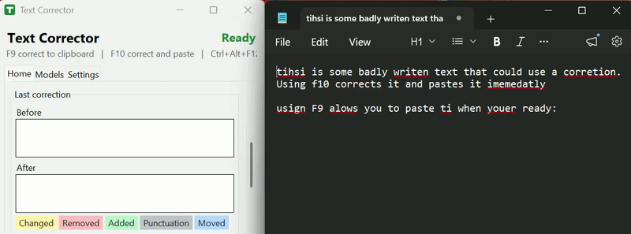
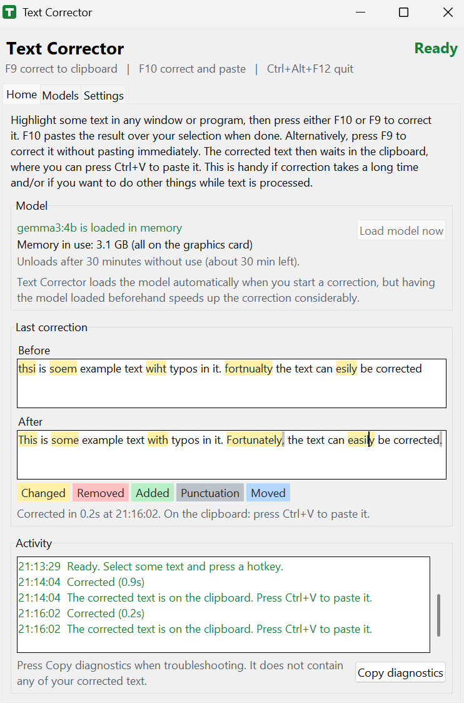
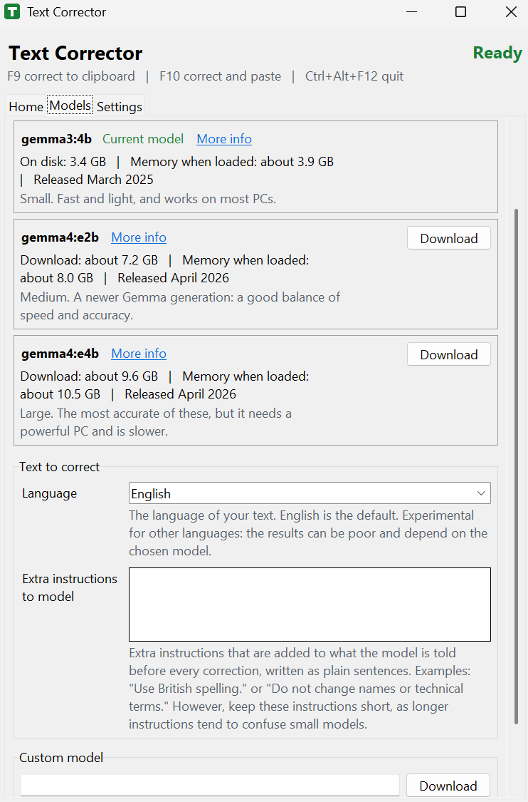
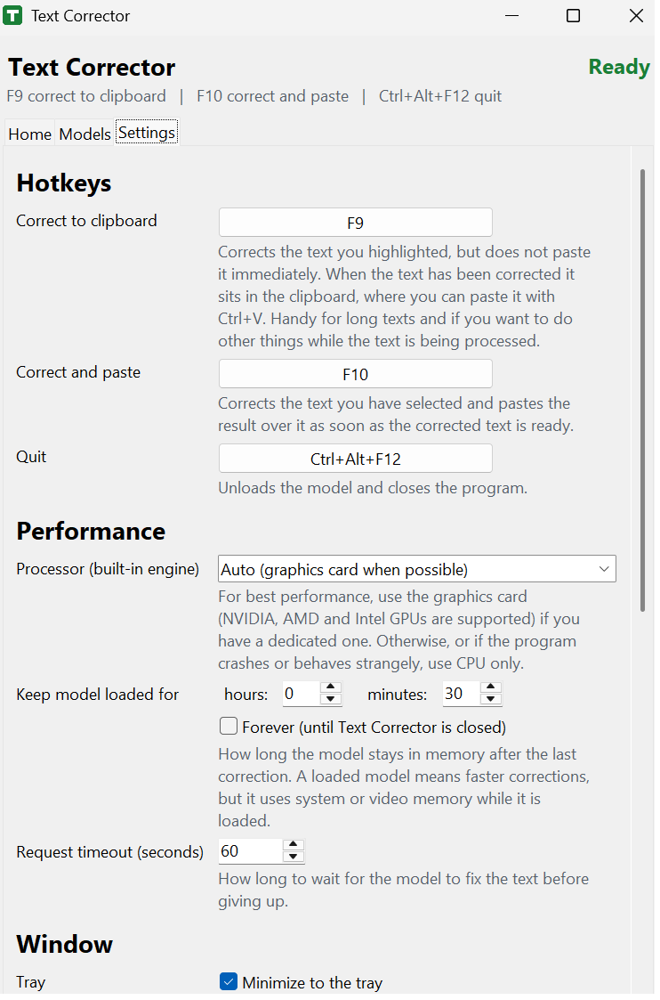

# Text Corrector

A simple Windows tool that fixes typos, spelling mistakes, grammar etc. using a local language model. Select some text in any
program or window, press a hotkey, and a moment later the corrected text is ready.
Everything runs on your own computer, using [Ollama](https://ollama.com) as the engine. After a
one-time download of a language model the whole thing is run offline.

## Download and use

1. Get the latest zip from the [Releases page](../../releases) (look under "Assets").
2. Extract it, double-click `TextCorrector.exe` and download a model.

No Python, no separate Ollama installation and no virtual environment are needed.
See [The ready-to-use zip](#the-ready-to-use-zip) for details.

**Requirements:** Windows 10 or 11 (64-bit). About 1.5 GB to download, a few GB of disk space once
extracted, and 3 to 10 GB for one of the language models you chose. The computer needs enough free
memory (RAM or graphics memory) for the model you choose; the Models tab shows roughly how much
each one needs. A graphics card is optional but makes text correction faster.

## How it works

1. You press a hotkey.
2. The tool copies your selection, sends it to a local Ollama model and asks for a corrected
   version (typos, spelling, casing and punctuation; wording and meaning stay the same).
3. The answer is checked and, depending on the hotkey, either pasted over your selection, or put on
   the clipboard, ready for you to paste with Ctrl+V.

Long texts are corrected paragraph by paragraph, so small models keep track and a part the model
keeps getting wrong is left as it was (the activity log says so) instead of losing the whole text.
If the model's answer does not look like a plain correction (for example extra commentary or
changed line breaks), nothing is pasted for that part and the program tells you why.

## Showcase and Screenshots

## Using the program

The window has three tabs:

- **Home:** the status, the model panel, the last correction (before and after) and a list of what
  the program has done. The model panel shows whether the model is loaded in memory, how much
  memory it uses (or roughly needs), and when it is unloaded after a period without use (the
  "Keep model loaded for" setting). **Load model now** loads it ahead of time, so the next
  correction does not have to wait for it. The program loads the model by itself when needed.
- **Models:** the models you can use. Download as many as you like (one at a time; the program
  is locked with a progress window until it is done), choose which one to use with **Use this
  model**, and **Remove** the ones you do not need. Each model shows its download size, roughly
  how much memory it needs, its release date and a **More info** link to its page. Smaller models
  are faster and need less memory; larger ones are usually more accurate. **Custom model** lets
  you download any model from the Ollama library by name. The **language** of your text and the
  **extra instructions to the model** are set here too, below the list.
- **Settings:** one control for every setting, with a description. Every change is applied and
  saved as soon as you make it.

At the bottom left of every tab is the credit line.

The tray icon is there from the start (unless you turn it off in Settings). When you minimize the
window it disappears into the tray (next to the clock); click the tray icon, or choose Open in its
menu, to bring it back. Choose Quit in the tray menu, press the quit hotkey, or close the window to
stop the program. On Windows 11 a new tray icon may be hidden under the small arrow next to the
clock until you drag it out. If the tray cannot be used, the activity log says why and the window
minimizes to the taskbar as usual. The background color of the tray icon, of the window icon and of
the icon in the taskbar shows the status: green is ready, yellowish is ready but the model is not
loaded, red is an error, and blue is loading or working. In Settings, turn off **Minimize to the
tray** to minimize to the taskbar instead; no tray icon is shown then.

On start the program loads the model and plays a short rising sound when it is ready. The status
at the top is green ("Ready") only while the model is also loaded in memory. It turns yellow when
only the program is ready and the model is not loaded, for example after it has been idle for
longer than the "Keep model loaded for" time. The model then loads again when you use it, which
takes a moment for the first correction.

| Hotkey | Action |
| --- | --- |
| F10 | **Correct and paste:** corrects the selected text and pastes the result over it |
| F9 | **Correct to clipboard:** corrects the selected text too, but does not paste: the corrected text waits on the clipboard until you press Ctrl+V. Handy for long texts, so you need not wait for the result |
| Ctrl+Alt+F12 | Quit |

All three hotkeys can be changed in the settings. Windows reserves a hotkey for this program
while it runs, so the program in front never receives it. This matters because many programs use
keys such as F10 for their own menu. If another program already uses a combination, this program
says so and you can choose another one.

After a correction, the **Before** and **After** boxes color what differs: changed words yellow,
removed words red, added words green, punctuation gray, and words that moved blue. You can turn
this off in Settings.

Only one copy of the program runs at a time: starting it again (for example from a taskbar pin)
brings the running window forward. Texts in the window, such as the last correction, can be marked
and copied. **Copy diagnostics** on the Home page copies a report about the program and its
latest errors (it contains no corrected text), handy when asking for help. Before a model
downloads, the program checks that there is enough free disk space.

By default the window opens large enough to show the whole Home page. On a small screen the Home
page gets a scroll bar instead of being cut off. When you close the program it remembers the window
size and uses it next time; **Reset window size** in the Settings tab goes back to the automatic
size.

## Settings

The Models tab also holds the **Language** of your text (English by default, "Detect automatically"
lets the model decide; experimental for other languages) and the **Extra instructions to model**
(plain sentences added to what the model is told for every correction, for example "Use British
spelling." Keep it short). The Settings tab holds the rest:

| Setting | What it does |
| --- | --- |
| Hotkeys | The key combinations. Click a button and press the new combination, or Esc to keep the old one |
| Keep model loaded for | How long the model stays in memory after the last use, as hours and minutes. **Forever** keeps it loaded until the program is closed |
| Request timeout | How long to wait for the model before giving up |
| Tray | Minimize to the tray (default), or to the taskbar |
| Start with Windows | Starts the program in the tray when you log in, without loading the model, so no memory is used until you correct something. Installed program only |
| Window size | **Reset window size** goes back to the automatic size from the next start |
| Processor (built-in engine) | Auto uses the graphics card (NVIDIA, AMD or Intel) when it can; CPU only uses just the processor. Try CPU only if the program crashes or behaves strangely on a PC |
| Sounds | Short sounds when the program is ready, when a correction starts, finishes, finds nothing to fix, or fails. Each has its own sound |
| Sound volume | The volume of all sounds together, from 0 (silent) to 100 (loudest) |
| Highlight changes | After a correction, the Before and After boxes color what differs: changed words yellow, removed words red, added words green, punctuation gray, and words that moved blue |

The settings are stored in `data\config.toml` in the program's folder, created on first start
with explanations next to every setting. Two settings are only in the file: the Ollama `url` (used
only with your own Ollama, not with the built-in engine) and the `temperature` (how much the answers
may vary; 0 is the most predictable). You can edit the file by hand too; restart the program for
those changes to apply. If a setting is invalid, the program tells you which one and does not
start. Delete the file to get a fresh copy with the defaults. Saving from the program rewrites the
file from the program's own template, so comments you added yourself are not kept.

## The ready-to-use zip

This is the version for casual users. Everything it needs is in its own folder.

1. Extract the zip to a folder you can write to, for example `C:\Users\YourName\TextCorrector`.
   Do not run the program from inside the zip.
2. Double-click `TextCorrector.exe`. Windows may warn about an unknown publisher the first
   time ("More info", then "Run anyway"), this is because the program is not signed as of writing this.
3. On first launch there is no large model yet, so the program opens on the Models tab. Press Download
   next to one (a few gigabytes, once). The progress is shown, and the model is used as soon as
   it is ready. Later you can download others there and switch between them.
4. To remove everything, close the program (tray icon, Quit) and delete the folder, or
   double-click `uninstall.bat` in it. Nothing else on the PC was changed.

### The built-in engine

The zip contains its own copy of Ollama's standalone service, renamed to `Text-Corrector-Engine.exe`,
to not confuse inexperienced users of where the process started from. The program starts it in the background when it
opens and stops it when it closes. It does not install anything in Windows, has no tray icon or
autostart of its own, and does not conflict with an Ollama you may have installed yourself: it uses
a free local port, and keeps its models, settings and temporary files in the program's folder
(`models` and `data`). Its log is `data\logs\ollama.log`.

Graphics cards: NVIDIA cards are used through CUDA, and AMD and Intel cards (also the ones
built into the processor) through Vulkan, with the normal graphics drivers. When no graphics
card can be used, the processor does the work, which is slower. The Model panel on the Home
page shows how much of the model sits on the graphics card and how much in system RAM.

To use your own Ollama instead of the built-in one, delete or rename the `ollama` folder next
to the program, and set your Ollama address in the config file.

## Troubleshooting

- **"The model did not answer in the expected format"**: the model replied with something other
  than the JSON answer the program asks for. Try again, or choose another model in the Models
  tab. Thinking models (such as Gemma 4) are asked not to think, and the program also accepts a
  reply wrapped in a code fence.
- **"The built-in engine is not answering"**: close Text Corrector and start it again. If it keeps
  happening, press **Copy diagnostics** on the Home page and check `data\logs\ollama.log`.
- **"The built-in engine could not start"**: read `data\logs\ollama.log` in the program's
  folder. Antivirus software sometimes blocks the engine (`ollama\Text-Corrector-Engine.exe`); allow it, or
  add the program's folder as an exception. If the log mentions the graphics card or driver,
  set "Processor (built-in engine)" to "CPU only" in the settings.
- **"No text was selected, or the app did not copy it"**: the program in front did not copy the
  selection. Some programs need a little longer to copy and paste. If it only happens in one
  program, try another hotkey in the settings.
- **A hotkey "cannot be used"**: another program has already taken that key combination.
  Choose a different one in the settings.
- **Cannot see the tray icon**: on Windows 11 it may be under the small arrow next to the clock.
  The activity log on the Home tab says if the tray icon could not be started.
- **Nothing appears when the program starts**: look for the tray icon. If the program stopped
  with an error, a message box says so, and details are saved in `data\error.log`.

## Known limitations

- Only text on the clipboard is restored afterwards when using correct and paste (F10). An image or file you had copied is lost.
- Language support depends on the model and is experimental. Results are likely to be poor in languages other than English.
- The program is not code-signed, so Windows shows a warning the first time. Some antivirus programs also flag programs made with PyInstaller by mistake.

## Credits

This project was inspired by two earlier tools, and thanks go to their authors:

- [ai-typing-assistant](https://github.com/patrickloeber/ai-typing-assistant) by Patrick Loeber
  (MIT license)
- [Typing-Assist](https://github.com/x404xx/Typing-Assist) by x404xx

This version has since been restructured and rewritten with its own code, and extended with
settings, text checks, feedback sounds and a graphical window.

## License

Text Corrector is free to use under the [MIT License](LICENSE). The built-in engine is
[Ollama](https://github.com/ollama/ollama) (MIT), and the language models you download are
separate works with their own licenses (see each model's page). The libraries the program uses
are listed in `THIRD_PARTY_NOTICES.txt` in the zip. The source code is not published yet.

## Feedback

Bug reports and ideas are welcome as GitHub issues. When reporting a problem, press **Copy
diagnostics** on the Home page and paste the result into the issue.
